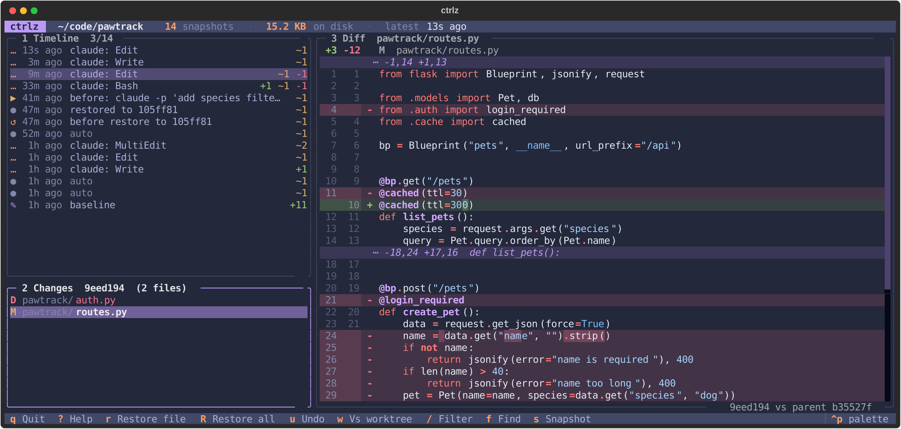
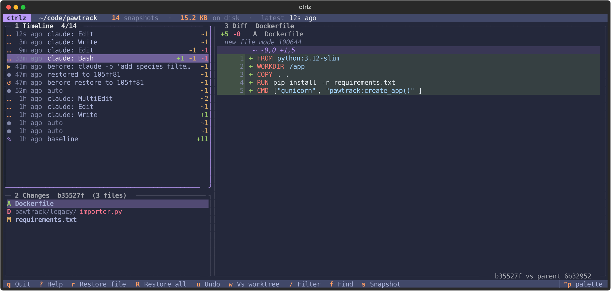

# ctrlz

**Undo anything.** ctrlz quietly snapshots your project on every change, so you can rewind whatever an AI coding agent (or you) broke, deleted or overwrote — even if you never committed.

```bash
pipx install "ctrlz[ui]"     # or: pip install "ctrlz[ui]"
cd my-project
ctrlz init                   # first snapshot
ctrlz start                  # background watcher: snapshot on every change
```



## Why

AI agents (Claude Code, Cursor, Codex, Aider, Copilot) edit dozens of files a minute. When one goes off the rails:

- **Their checkpoints are partial.** They track the agent's own edit tool, not `rm -rf`, `sed -i`, code generators or `git checkout .` run from a shell.
- **Their checkpoints are tool-specific** and vanish with the session.
- **git only protects what you committed.** Your last hour of uncommitted work isn't in it.

ctrlz works with any agent, any editor, in any folder (git repo or not), and **never touches your real git history, branches, index or stash**.

## Use it

```bash
ctrlz undo                      # revert the most recent change
ctrlz log                       # timeline of snapshots
ctrlz diff                      # what changed since the last snapshot
ctrlz restore -10m              # whole project back to 10 minutes ago
ctrlz restore @~3 src/auth.py   # one file back 3 snapshots
ctrlz find "def login"          # when did this appear / disappear?
ctrlz cat -1h config.yaml       # print a file as it was an hour ago
ctrlz ui                        # interactive timeline (screenshot above)
```

Every restore takes a snapshot first, so **a restore is itself undoable** (`ctrlz undo` twice = redo).

### Wrap an agent session

```bash
ctrlz run -- claude
ctrlz run -- aider --model sonnet
```

Snapshots before and after the command, passes through stdin/stdout, Ctrl+C and the exit code, then tells you what changed:

```text
ctrlz: the run changed files +1 ~1 -1 - rewind with `ctrlz undo`
```

### Claude Code: snapshot after every tool call

```bash
ctrlz hooks install claude-code            # this project (.claude/settings.json)
ctrlz hooks install claude-code --global   # all projects (~/.claude/settings.json)
```

This adds a `PostToolUse` hook for `Edit|Write|MultiEdit|NotebookEdit|Bash`, so every edit and shell command is a separate step you can rewind — labelled `claude: Edit`, `claude: Bash`, … in the timeline. The hook takes ~80 ms, always exits 0 (it can never block the agent), and merges into your existing settings without touching other hooks. `ctrlz hooks uninstall claude-code` removes only its own entry.

## Refs

Anywhere a snapshot is expected:

| Ref | Meaning |
|---|---|
| `@` | latest snapshot |
| `@~3` | 3 snapshots before the latest |
| `-10m`, `-2h`, `-1d` | latest snapshot at or before that long ago |
| `f92ce18` | a snapshot id from `ctrlz log` |

## The TUI

`ctrlz ui` (needs the `ui` extra) shows the timeline, the files each snapshot changed, and a syntax-highlighted diff. It updates live while an agent works.

| Key | Action |
|---|---|
| `↑ ↓` / `j k` | move · `tab` switch pane |
| `r` / `R` | restore file / whole snapshot (with preview) |
| `u` | undo last change |
| `w` | diff vs working tree |
| `/` · `f` | filter timeline by path · find text in history |
| `s` · `?` · `q` | snapshot now · help · quit |



## How it works

- Snapshots live in a separate, hidden git object store: `.git/ctrlz/` inside a repo, or `.ctrlz/` in a plain folder. Files are deduplicated by content, so 1,000 snapshots of a project cost little more than the changes between them.
- Each snapshot is a commit on a private ref (`refs/ctrlz/timeline`) built with git plumbing and its own index file. Your `HEAD`, branches, index, stash and config are never read for writing — the test suite hashes your entire `.git` directory before and after every operation to prove it.
- Respects `.gitignore` and `.git/info/exclude`, plus an optional `.ctrlzignore`. Dependency and cache folders (`node_modules/`, `.venv/`, `__pycache__/`, …) are skipped by default; re-include one with `!node_modules/` in `.ctrlzignore`. Files over 50 MB are skipped.
- The watcher waits for edits to settle (1.5 s), but never lets more than 10 s of continuous changes go unsnapshotted.
- Old snapshots thin out automatically with `ctrlz prune`: everything from the last hour, one per 10 minutes for a day, hourly for a week, daily for 90 days.

Performance on a 5,000-file project: a no-change check takes ~35 ms, a one-file change ~45 ms.

## All commands

```text
ctrlz init                         create the store and take the first snapshot
ctrlz snap [-m LABEL]              snapshot now
ctrlz watch                        watch in the foreground (Ctrl+C to stop)
ctrlz start | stop | status        background watcher
ctrlz log [-n N] [--since 2h] [-- PATH]
ctrlz show REF                     snapshot details and changed files
ctrlz diff [REF [REF2]] [-- PATHS]
ctrlz restore REF [PATHS...] [--keep-new] [-y]
ctrlz undo [-y]
ctrlz cat REF PATH
ctrlz find TEXT [--regex] [-- PATH]
ctrlz run -- CMD...
ctrlz hooks install|uninstall claude-code [--global]
ctrlz prune [--dry-run]
ctrlz stats
ctrlz ui
```

`log`, `show` and `stats` accept `--json`.

## Requirements and limits

- Python 3.10+ and `git` 2.30+ on your PATH. Linux and macOS are fully tested; Windows is supported but less battle-tested.
- Nested git repos and submodules are not snapshotted (restore leaves them alone).
- ctrlz is an undo safety net on your own disk, not a backup. Keep pushing to a remote.

## Development

```bash
git clone https://github.com/rishitmpatel/ctrlz && cd ctrlz
pip install -e ".[dev]"
python -m pytest -q        # 125 tests
```

## License

MIT
